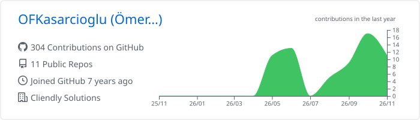
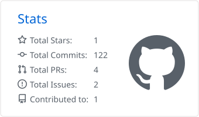
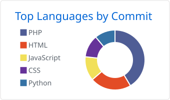

<!-- ===================== HEADER ===================== -->
<p align="center">
  
</p>

<p align="center">
  <a href="https://github.com/OFKasarcioglu">
    
  </a>
</p>

<p align="center">
  <a href="https://www.linkedin.com/in/omrfrkksrcglu"></a>
  <a href="https://x.com/OFKasarcioglu"></a>
  <a href="https://instagram.com/ofkasarciogludev"></a>
  <a href="mailto:omr.frk.ksrcglu@gmail.com"></a>
  <a href="https://cliendly.com"></a>
</p>

<p align="center">
  
</p>

<p align="center">
  <a href="#-english">🇬🇧 English</a> &nbsp;•&nbsp; <a href="#-türkçe">🇹🇷 Türkçe</a> &nbsp;•&nbsp; <a href="#-tech-stack">💻 Tech Stack</a> &nbsp;•&nbsp; <a href="#-github-stats">📊 Stats</a>
</p>

---

## 🇬🇧 English

### 👨‍💻 About Me

I'm a **Senior Developer at [Cliendly Solutions](https://cliendly.com)**, based in Kocaeli, Türkiye. I specialize in building robust, maintainable web applications with **PHP and Laravel**, and I enjoy working across the stack, from database design to polished front-end experiences with **React**.

I care about clean architecture, readable code and products that actually solve real business problems.

```php
<?php

namespace Cliendly\Team;

final class OmerFaruk extends Developer
{
    public string $role     = 'Senior Developer';
    public string $company  = 'Cliendly Solutions';
    public string $location = 'Kocaeli, Türkiye';

    public array $expertise = ['PHP', 'Laravel', 'CodeIgniter'];
    public array $alsoUse   = ['JavaScript', 'React', 'Python', 'Django'];

    public function beyondCode(): array
    {
        return ['Psychology Coach 🧠', 'Bookworm 📚', 'Fenerbahçe 💛💙'];
    }

    public function motto(): string
    {
        return 'Write code that the next developer will thank you for.';
    }
}
```

### ⚡ Right Now

- 🏢 Building software products and client solutions at **Cliendly Solutions**
- 💬 Ask me about **PHP, Laravel & CodeIgniter**
- 🌱 Expanding my toolkit with **Python & Django**
- 🧠 Also a **psychology coach**, which helps me understand users and teams better

### 🤝 Let's Work Together

Need a reliable web application, an API or a Laravel project taken to the next level? Reach out by [email](mailto:omr.frk.ksrcglu@gmail.com) or on [LinkedIn](https://www.linkedin.com/in/omrfrkksrcglu), or visit **[cliendly.com](https://cliendly.com)**.

---

## 🇹🇷 Türkçe

<details>
<summary><b>Türkçe tanıtımı görmek için tıklayın</b></summary>
<br />

### 👨‍💻 Hakkımda

Kocaeli'de yaşayan, **[Cliendly Solutions](https://cliendly.com)** bünyesinde çalışan bir **Kıdemli Yazılım Geliştiriciyim**. **PHP ve Laravel** ile sağlam, sürdürülebilir web uygulamaları geliştirme konusunda uzmanım; veritabanı tasarımından **React** ile hazırlanan kullanıcı arayüzlerine kadar projenin her katmanında çalışmayı seviyorum.

Temiz mimariye, okunabilir koda ve gerçek iş problemlerini çözen ürünlere önem veriyorum.

### ⚡ Şu Sıralar

- 🏢 **Cliendly Solutions**'ta yazılım ürünleri ve müşteri çözümleri geliştiriyorum
- 💬 **PHP, Laravel ve CodeIgniter** hakkında her şeyi sorabilirsiniz
- 🌱 **Python ve Django** ile yetkinliklerimi genişletiyorum
- 🧠 Aynı zamanda **psikoloji koçuyum**; bu, kullanıcıları ve ekipleri daha iyi anlamamı sağlıyor
- 📚 Sıkı bir kitap kurdu ve 💛💙 Fenerbahçe taraftarıyım

### 🤝 Birlikte Çalışalım

Güvenilir bir web uygulamasına, API'ye ya da Laravel projenizi bir üst seviyeye taşıyacak birine mi ihtiyacınız var? [E-posta](mailto:omr.frk.ksrcglu@gmail.com) veya [LinkedIn](https://www.linkedin.com/in/omrfrkksrcglu) üzerinden yazabilir, **[cliendly.com](https://cliendly.com)** adresini ziyaret edebilirsiniz.

</details>

---

## 💻 Tech Stack

<table align="center">
  <tr>
    <td align="center" width="33%"><b>Backend</b></td>
    <td align="center" width="33%"><b>Frontend</b></td>
    <td align="center" width="33%"><b>Tools &amp; Design</b></td>
  </tr>
  <tr>
    <td align="center">
      <br /><br />
      
    </td>
    <td align="center">
      <br /><br />
      
    </td>
    <td align="center">
      
    </td>
  </tr>
</table>

## 📊 GitHub Stats

<p align="center">
  <picture>
    <source media="(prefers-color-scheme: dark)" srcset="https://raw.githubusercontent.com/OFKasarcioglu/OFKasarcioglu/main/profile-summary-card-output/github_dark/0-profile-details.svg" />
    
  </picture>
</p>

<p align="center">
  <picture>
    <source media="(prefers-color-scheme: dark)" srcset="https://raw.githubusercontent.com/OFKasarcioglu/OFKasarcioglu/main/profile-summary-card-output/github_dark/3-stats.svg" />
    
  </picture>
  <picture>
    <source media="(prefers-color-scheme: dark)" srcset="https://raw.githubusercontent.com/OFKasarcioglu/OFKasarcioglu/main/profile-summary-card-output/github_dark/2-most-commit-language.svg" />
    
  </picture>
</p>

<p align="center">
  <picture>
    <source media="(prefers-color-scheme: dark)" srcset="https://streak-stats.demolab.com?user=OFKasarcioglu&hide_border=true&background=0D1117&ring=0A6EFF&fire=0A6EFF&currStreakLabel=0A6EFF&sideLabels=C9D1D9&dates=8B949E&currStreakNum=FFFFFF&sideNums=FFFFFF&stroke=30363D" />
    
  </picture>
</p>

<p align="center">
  <picture>
    <source media="(prefers-color-scheme: dark)" srcset="https://raw.githubusercontent.com/OFKasarcioglu/OFKasarcioglu/output/github-snake-dark.svg" />
    
  </picture>
</p>

<p align="center">
  <i>“Write code that the next developer will thank you for.”</i>
</p>

<!-- ===================== FOOTER ===================== -->
<p align="center">
  
</p>
